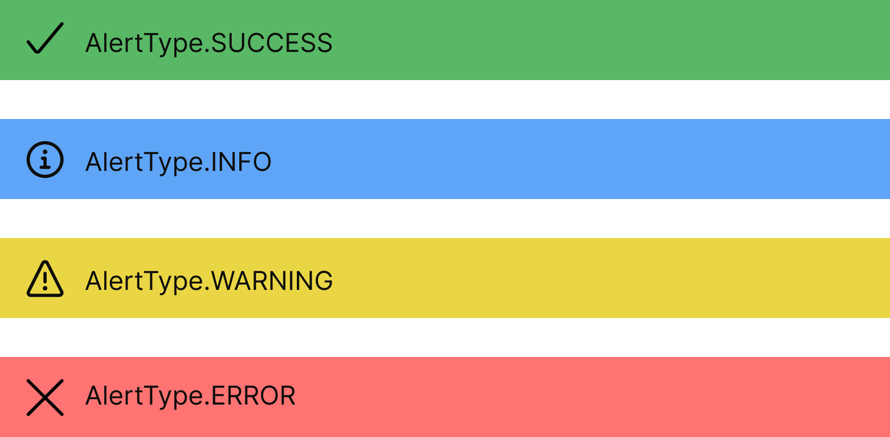

[](https://www.python.org)
[](https://opensource.org/licenses/MIT)
[](https://pypistats.org/packages/tk-alert)

# tk-alert

> Lightweight, self-contained package for sending GUI alerts using tkinter.

## Table of Contents

1. **[Introduction](#tk-alert)**  
2. **[Features](#features)**  
3. **[Usage](#usage)**  
   - **[Setup](#1-setup)**  
   - **[Example Code](#2-example-code)**  
   - **[Options](#3-options)**  
   - **[Customization](#4-customization)**  
   - **[Configuration](#5-configuration)**  
   - **[Default Alert Design](#6-default-alert-design)**  
4. **[Known Limitations](#known-limitations)**  
5. **[Development](#development)**  
6. **[Roadmap Items](#roadmap-items)**  
7. **[License](#license)**  
  
## Features

- Two lines to send an alert: create an `AlertGenerator`, call `.send()`
- Four alert types (success, info, warning, error) and nine anchor positions
- Alerts on the same anchor stack, and close the gap when one goes away
- Click an alert to dismiss it, or let it disappear after its duration
- Long text is truncated with an ellipsis and re-fitted when the window is resized
- Every `tk.Button` option can be passed through to restyle an alert
- No dependencies beyond tkinter
  
## Usage

This example demonstrates how to create a basic Tkinter window and utilize the `tk-alert` library to display an alert notification when a button is clicked.

### 1. Setup

First, install the library using pip (or `uv add tk-alert` in a uv project):

```sh
pip install tk-alert
```

### 2. Example Code

```python
import tkinter as tk
import tk_alert as tk_a

if __name__ == "__main__":
    app = tk.Tk()
    app.geometry("800x800")

    alert_generator = tk_a.AlertGenerator(app)

    show_notification_btn = tk.Button(app)
    show_notification_btn.configure(
        text="Send Alert",
        command=lambda: alert_generator.send(
            text="Alert information: Lorem Ipsum Dolor Sit Amet",
            type=tk_a.AlertType.INFO,
            anchor=tk.NW,
            duration=5
        ),
    )
    show_notification_btn.pack()

    app.mainloop()
```

### 3. Options

Arguments of `AlertGenerator.send()`:

| Argument | Default | Allowed values | Description |
|---|---|---|---|
| `text` | required | any string | Message shown in the alert. |
| `type` | required | `AlertType.SUCCESS`, `AlertType.INFO`, `AlertType.WARNING`, `AlertType.ERROR` | Sets the default colour and icon. |
| `anchor` | `tk.NW` | `tk.NW`, `tk.N`, `tk.NE`, `tk.W`, `tk.CENTER`, `tk.E`, `tk.SW`, `tk.S`, `tk.SE` | Where in the parent the alert is placed. |
| `duration` | `2` | number, 0 or greater | Seconds before the alert disappears. |
| `margin` | `15` | number, 0 or greater | Pixels between the alert and the edge of the parent. |
| `width_percentage` | `0.33` | greater than 0, up to 1 | Width of the alert as a fraction of the parent's width. |
| `min_width` | `0` | number, 0 or greater | Width in pixels the alert never gets narrower than. `0` means no minimum. |
| `**kwargs` | | any `tk.Button` option | Passed to the alert widget, see [Customization](#4-customization). |

The defaults above can be changed for a whole generator, see [Configuration](#5-configuration). An invalid value raises `ValueError` or `TypeError` before anything is shown.

### 4. Customization

An alert is a `tk.Button`, so any button option overrides the default design:

```python
alert_generator.send(
    text="Saved to disk",
    type=tk_a.AlertType.SUCCESS,
    font=("Helvetica", 12, "bold"),
    background="#222222",
    foreground="#FFFFFF",
    command=lambda: print("Alert clicked"),
)
```

Passing your own `command` replaces the default click-to-dismiss behaviour; the alert still disappears after its duration.

### 5. Configuration

To avoid repeating the same options on every call, set them once with an `AlertConfig` and pass it to the generator:

```python
config = tk_a.AlertConfig(
    anchor=tk.SE,
    duration=5,
    margin=20,
    width_percentage=0.4,
    button_options={"font": ("Helvetica", 12)},
)

alert_generator = tk_a.AlertGenerator(app, config)

# Uses the config
alert_generator.send("Saved to disk", tk_a.AlertType.SUCCESS)

# An argument passed to send() overrides the config for that alert only
alert_generator.send("Could not save", tk_a.AlertType.ERROR, duration=10)
```

`AlertConfig` takes `anchor`, `duration`, `margin`, `width_percentage` and `min_width` with the same defaults and allowed values as `send()`, plus `button_options`, a dict of `tk.Button` options applied to every alert. One config can be shared between several generators.

### 6. Default Alert Design



## Known Limitations

- The parent of an alert must be a container: `tk.Tk`, `tk.Toplevel`, `tk.Frame`, `tk.LabelFrame`, `tk.Canvas`, `tk.PanedWindow`, `ttk.Frame`, `ttk.LabelFrame` or `ttk.Notebook` (or a subclass). Other widgets, such as a `tk.Label`, are rejected.
- Alert text is a single line. Text that does not fit is truncated, and there is no way yet to read the rest.
- Stacking is tracked per `AlertGenerator`. Alerts sent by two generators to the same parent and anchor overlap.

## Development

The project is managed with [uv](https://docs.astral.sh/uv/). Packaging metadata lives in `pyproject.toml` and the build backend is `uv_build`. The test suite is run on Python 3.8 to 3.14.

```sh
# Create .venv and install the package (editable) plus dev dependencies
uv sync

# Run the tests (they open Tk windows, so a display is required)
uv run pytest

# Run the tests against another Python version (uv downloads it if needed)
uv run --isolated --python 3.12 pytest

# Try the example app
uv run example.py
```

### Build and publish

```sh
# Bump the version in pyproject.toml (patch | minor | major)
uv version --bump patch

# Build the sdist and wheel into dist/
uv build

# Upload to PyPI (needs a PyPI token, e.g. in UV_PUBLISH_TOKEN)
uv publish
```

## Roadmap Items

This package is a **work in progress**. Below is the roadmap for the upcoming developments I wish to implement:

- [ ] **Tooltip on Hover**: Whenever the text inside the alert is truncated, a tooltip should appear on hover.
- [x] **Support for Multiple Python 3 Versions**: Extend compatibility to support multiple versions of Python 3.
- [x] **Tests**: Implement testing to ensure code reliability.
- [x] **Stacking**: Alerts sent to the same anchor stack instead of overlapping.
- [x] **Configuration System for the AlertGenerator Class**: Develop a configuration system where a config object can be created and injected into the class. This will eliminate the need to pass configurations at runtime every time the `.send()` method is called.
- [ ] **Better Icon Support**: Enhance icon support, allowing users to change icons rather than relying on predefined options.
- [x] **Minimum Width Constraint**: Implement a feature to constrain the alert with a `min_width` argument.
- [ ] **Animations**: Implement an animation system.

## License

This project is licensed under the **MIT License**. See the [LICENSE](https://github.com/DragosPancescu/tk-alert/blob/main/LICENSE.txt) file for more details.

The default icons are from [Streamline](https://streamlinehq.com), licensed under CC BY 4.0. See [notices.md](https://github.com/DragosPancescu/tk-alert/blob/main/notices.md).
